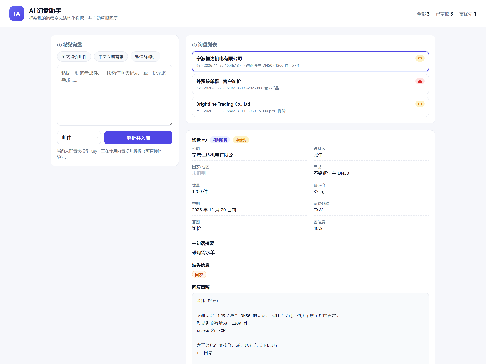

# AI 询盘助手 · Inquiry Agent

把杂乱的询盘（邮件、微信聊天、采购需求）一键变成**结构化数据 + 可直接改用的回复草稿**。

> 零配置即可运行：**不填任何 API Key 也能跑**（内置规则解析），填上大模型 Key 后质量和覆盖面更强。



---

## 解决什么问题

一句话：**把散落在邮件、微信、PDF 里的询盘，变成一条条能查、能跟、能直接回复的结构化记录。**

背后是四个每天都在发生的痛点：

| 痛点 | 现在的做法 | 用了之后 |
| --- | --- | --- |
| 询盘散在邮件 / 微信群 / PDF，格式不统一 | 一条条读、一条条抄进 Excel，20 条要抄半小时 | 粘贴进来，自动抽成 12 个字段 |
| 数量、目标价、交期、贸易条款埋在长文本里 | 靠人眼找，容易看漏，报价出错 | 关键字段独立成列，一眼可见 |
| 回信前要先翻记录找信息 | 来回翻原文，响应慢，单子容易被抢 | 基于已抽字段直接生成回复草稿 |
| 跟进状态全在个人脑子里 | 谁跟过、缺什么信息、哪些最急，人一请假就断 | 台账 + 缺失信息提示 + 紧急度排序 |

这个项目解决的就是这条链路：**读进来 → 抽成结构 → 存下来 → 顺手把回复也草拟好。**

它不是"再做一个聊天机器人"，而是把"重复性信息搬运"这件事自动化掉——这正是业务数字化里最典型、最容易见效的一类问题。

### 边界：它不做什么

- **不做报价决策**：价格由人定，它只负责把报价需要的信息凑齐。
- **不自动发信**：草稿要人过一眼再发，AI 只做初稿。
- **不是完整 CRM**：只切片"询盘进来"这一环，不碰订单、物流、财务。

## 它会做什么

```text
粘贴询盘（邮件 / 微信 / 采购单）
        ↓
① 抽取 12 个字段（公司、联系人、国家、产品、数量、目标价、交期、贸易条款、紧急度、意图、摘要、缺失信息）
        ↓
② 落库，形成可筛选的询盘台账
        ↓
③ 基于缺失信息，自动草拟一封中/英回复
        ↓
④ 一键复制，直接发给客户
```

## 60 秒体验

只需要装 Python 3.9+（[下载](https://www.python.org/downloads/)，安装时勾选 **Add Python to PATH**），然后按你的系统选一种：

| 系统 / 方式 | 一条命令 |
| --- | --- |
| Windows | 双击 `start.bat` |
| macOS / Linux | `bash start.sh` |
| 任意命令行 | `pip install -r requirements.txt` && `python run.py` |
| Docker | `docker build -t inquiry-agent .` && `docker run -p 8000:8000 inquiry-agent` |

浏览器会自动打开 **http://127.0.0.1:8000**；如果 8000 端口被别的程序占用，会自动换一个端口，具体地址看终端里打印的那行。

打开后**不需要准备任何数据**：点左上角三个样例按钮中的任意一个 → 点「解析并入库」，右边立刻出现结构化字段、缺失信息和一封可直接改用的回复草稿。

不需要申请 API Key，也不用手动建数据库：没配 Key 时自动走内置规则解析，数据库首次运行自动创建。

## 部署到线上（免费，让别人点链接就能用）

仓库里带了 `render.yaml`，用 [Render](https://render.com) 的免费实例可以零成本上线：

1. 用 GitHub 账号登录 Render → **New** → **Blueprint**
2. 选中本仓库 → **Apply**，等 2~3 分钟构建完成
3. 拿到形如 `https://inquiry-agent.xxx.onrender.com` 的公网链接，发给任何人都能打开

免费实例的两个已知限制（演示完全够用）：

- 15 分钟无人访问会休眠，下次打开需要等 30~60 秒唤醒
- 磁盘是临时的，实例重启后询盘数据会清空，重新点样例即可再演示

想常驻不休眠、数据持久，再升级到付费实例即可（约 $7/月），代码不用改。

## 可选：接入大模型

不配置也能用。想获得更好的抽取和草拟质量，复制 `.env.example` 为 `.env`，填入任意 OpenAI 兼容接口：

```bash
cp .env.example .env
```

```ini
# DeepSeek 示例
LLM_API_KEY=sk-xxxxxxxx
LLM_BASE_URL=https://api.deepseek.com/v1
LLM_MODEL=deepseek-chat
```

支持 OpenAI / DeepSeek / Kimi / 通义等任何 OpenAI 兼容服务。

## 常见问题

**要花钱吗？** 不用。项目本身免费，不配 Key 也能完整跑通；只有你自己主动接入大模型 API 时才会产生对应服务商的费用。

**我的询盘数据会被上传吗？** 默认不会。不配 Key 时全部在本机计算，数据只写进本地的 `data/inquiries.db`。只有你配置了 `LLM_API_KEY`，询盘文本才会发给你指定的那家模型服务商。

**数据存在哪？怎么清空？** 存在 `data/inquiries.db`。直接删掉这个文件，下次启动会自动重建一个空库。

**端口 8000 被占用怎么办？** 不用管，会自动换到 8001、8002……，终端里会打印实际地址。

## 工作原理

```text
┌──────────────┐     POST /api/inquiries      ┌────────────────┐
│  浏览器前端   │ ───────────────────────────► │   FastAPI 后端  │
│  (原生 JS)    │ ◄─────────────────────────── │                │
└──────────────┘     JSON（询盘 + 草稿）        └───────┬────────┘
                                                       │
                              ┌────────────────────────┼─────────────────────┐
                              ▼                        ▼                     ▼
                     ┌─────────────────┐      ┌─────────────────┐   ┌──────────────┐
                     │  extractor.py   │      │  drafter.py     │   │   db.py      │
                     │ 大模型 or 规则   │      │ 大模型 or 模板   │   │  SQLite 自动建库│
                     └─────────────────┘      └─────────────────┘   └──────────────┘
```

**关键设计：双层降级。**
每个 AI 环节都有"大模型 → 规则/模板"的兜底路径。这样任何人 clone 下来，**不配 Key 也能 100% 跑通全流程**，不会卡在第一步。

## 抽取字段

| 字段 | 含义 | 示例 |
|---|---|---|
| company | 客户公司 | Brightline Trading Co., Ltd |
| contact | 联系人 | Michael Chen |
| country | 国家/地区 | 美国 |
| product | 产品/型号 | LED Panel Light PL-6060 |
| quantity | 数量 | 5,000 pcs |
| target_price | 目标价 | USD 8.5 |
| delivery | 交期 | 30 days |
| incoterm | 贸易条款 | FOB |
| urgency | 紧急度 | high / medium / low |
| intent | 意图 | 询价 / 样品 / 售后 / 合作 / 其他 |
| summary | 一句话摘要 | — |
| missing_info | 缺失信息 | ["联系人", "交期"] |
| confidence | 置信度 | 0–1 |

## API

| 方法 | 路径 | 说明 |
|---|---|---|
| GET | `/api/health` | 健康检查，返回是否已接入大模型 |
| GET | `/api/samples` | 内置样例 |
| POST | `/api/inquiries` | 解析并入库，body：`{"text": "...", "source": "email"}` |
| GET | `/api/inquiries` | 询盘列表 |
| GET | `/api/inquiries/{id}` | 单条详情 |
| POST | `/api/inquiries/{id}/draft` | 生成回复草稿 |
| GET | `/api/stats` | 统计（全部 / 已草拟 / 高优先） |

## 目录结构

```text
inquiry-agent/
├── run.py                  # 一键启动（自动选端口、自动开浏览器）
├── start.bat               # Windows 双击启动
├── start.sh                # macOS / Linux 启动
├── requirements.txt
├── .env.example            # 大模型配置模板
├── Dockerfile
├── docs/screenshot.png     # 界面截图
├── samples/                # 样例询盘（可直接体验）
├── data/                   # SQLite 数据库（自动生成，已 gitignore）
└── app/
    ├── main.py             # FastAPI 路由与页面
    ├── config.py           # 环境配置
    ├── db.py               # SQLite 存储层
    ├── extractor.py        # 字段抽取（大模型 / 规则）
    ├── drafter.py          # 回复草拟（大模型 / 模板）
    ├── models.py
    └── static/             # 前端页面
```

## 设计取舍

- **为什么用 SQLite 而不是 MySQL**：这是一个"开箱即用"的工具，目标是任何人 clone 就能跑。SQLite 零安装、单文件，后续要换 Postgres 只需改 `db.py` 一处。
- **为什么做双层降级**：演示和开源项目最大的失败原因是"跑不起来"。规则兜底保证了最低体验。
- **为什么前端用原生 JS**：不引入构建链，减少"npm install 失败"的风险，别人打开就能用。
- **为什么字段要标 confidence**：让使用者知道哪些是"高把握"，哪些需要人工复核——AI 落地必须留人工兜底。

## 路线图

- [ ] 批量导入（拖拽多个文件 / 文件夹）
- [ ] 写入飞书多维表格 / 钉钉 AI 表格
- [ ] 回复模板可配置（按产品线 / 客户类型）
- [ ] 询盘去重与客户合并
- [ ] 导出 Excel

## License

MIT，见 [LICENSE](LICENSE)。
